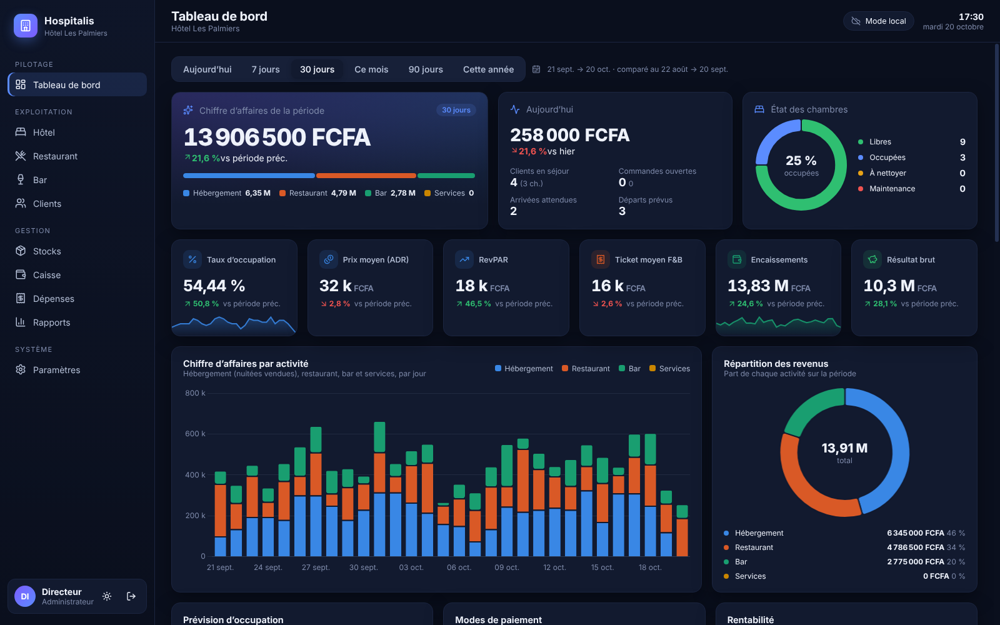
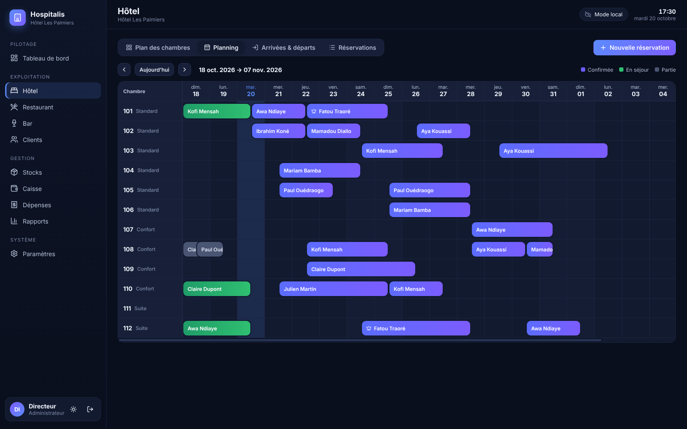
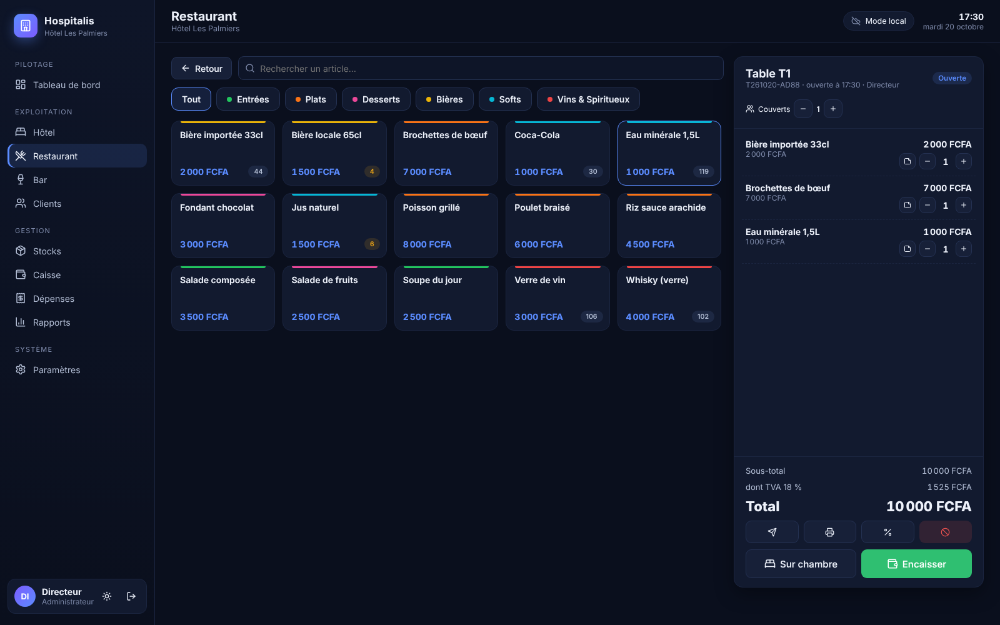
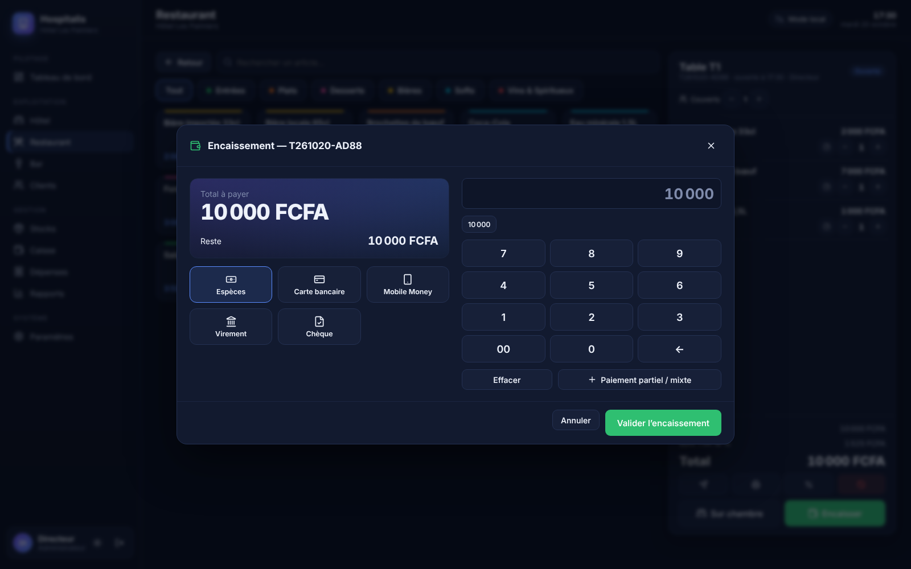

# Hospitalis — Hôtel · Bar · Restaurant

Logiciel de gestion tout-en-un pour Windows : **hôtel, bar et restaurant dans une seule application**, avec un tableau de bord complet.
Il fonctionne **entièrement sans Internet** (base de données locale sur chaque poste) et se **synchronise automatiquement avec votre VPS** dès que la connexion est disponible.



| Planning hôtel | Caisse restaurant | Encaissement |
|---|---|---|
|  |  |  |

---

## Fonctionnalités

### Tableau de bord
- Chiffre d’affaires de la période et répartition **Hébergement / Restaurant / Bar / Services**, comparés à la période précédente
- Indicateurs hôteliers : **taux d’occupation, ADR (prix moyen), RevPAR**, nuitées vendues
- Indicateurs bar et restaurant : **ticket moyen, couverts, food cost**, top 10 des ventes avec marges
- **Rentabilité** : CA, coût des marchandises vendues, dépenses, résultat brut, marge nette
- Graphiques : CA quotidien empilé par activité, prévision d’occupation sur 14 jours, évolution de l’occupation, modes de paiement, heures de pointe, jours de la semaine, dépenses par catégorie, canaux de réservation
- Opérationnel du jour : arrivées, départs, clients présents, commandes ouvertes, état des chambres, alertes de stock, classement de l’équipe, journal d’activité
- Périodes : aujourd’hui, 7 j, 30 j, mois en cours, 90 j, année. Thème sombre ou clair.

### Hôtel
- **Plan des chambres** par étage, avec statut (libre, occupée, à nettoyer, maintenance) et gestion du ménage
- **Planning** visuel (21 jours) : cliquer sur une case libre crée une réservation
- Réservations avec contrôle automatique des **doubles réservations**, clients nouveaux ou existants, provenance (Booking, Expedia, direct…)
- **Check-in / check-out**, note de séjour (folio) : nuitées, taxe de séjour, prestations (blanchisserie, transfert…), consommations bar/restaurant transférées sur la chambre, paiements partiels
- **Facture** imprimable ou en PDF (TVA détaillée)
- Annulation, no-show, arrivées et départs du jour

### Bar et Restaurant (caisse tactile)
- Plan de salle par zones (salle, terrasse, comptoir…), tables occupées avec montant et serveur
- Prise de commande tactile par catégorie, recherche, notes (« sans piment », cuisson…), couverts
- **Bon cuisine / bar** imprimé à l’envoi, addition, remise (montant ou %)
- **Encaissement** : espèces (calcul du rendu), carte, Mobile Money, virement, chèque, **paiement mixte**
- **Transfert sur la chambre** d’un client présent
- Annulation avec motif obligatoire (tracée dans le journal d’audit), historique et réimpression des tickets

### Stocks
- Articles, catégories, fournisseurs, prix de vente, coût d’achat et marge
- **Déstockage automatique** à chaque vente, entrées (réceptions), pertes, sorties, ajustements
- **Inventaire physique** avec calcul des écarts, alertes sous le seuil, valeur du stock

### Gestion
- **Caisse** : rapport Z de clôture (par mode de paiement, par activité, espèces attendues), journal des encaissements filtrable
- **Dépenses** par catégorie et fournisseur
- **Rapports** : CA journalier par activité, ventes par article avec marges, export **Excel (CSV)** et **PDF**
- **Journal d’audit** de toutes les opérations sensibles
- **Utilisateurs avec code PIN** et rôles : administrateur, gérant, réception, serveur, barman, caissier (chacun ne voit que ses écrans)
- Sauvegarde automatique quotidienne (30 jours conservés), sauvegarde et restauration manuelles

---

## Installation sur Windows

### Option 1 — Télécharger l’installateur (recommandé)
Le dépôt contient un workflow GitHub Actions qui construit l’installateur sur une machine Windows :
1. Sur GitHub, ouvrez l’onglet **Actions** › **« Hospitalis — installateur Windows »** › **Run workflow** (il se lance aussi à chaque envoi sur `main`).
2. À la fin, téléchargez l’artefact **Hospitalis-Windows** : il contient `Hospitalis-Setup-1.0.0.exe` (installateur) et une version portable `.zip`.
3. Lancez l’installateur sur chaque poste (réception, bar, restaurant, bureau du gérant…).

> Windows SmartScreen peut afficher un avertissement car l’application n’est pas signée : cliquez sur « Informations complémentaires » › « Exécuter quand même ».

### Option 2 — Construire soi-même sur un PC Windows
Installez [Node.js 24](https://nodejs.org), puis dans le dossier du projet :
```bash
npm install
npm run dist:win      # → release/Hospitalis-Setup-1.0.0.exe
```

### Premier démarrage
L’application demande le nom de l’établissement et crée le compte administrateur (votre code PIN).
Cochez « données de démonstration » pour découvrir le logiciel avec des chambres, une carte et deux mois d’historique ;
trois employés de démonstration sont alors créés : **1111** (serveuse), **2222** (barman), **3333** (réception).
Pour démarrer en production, installez sans les données de démonstration, puis configurez **Paramètres › Chambres**, **Tables**, **Stocks › Articles** et **Utilisateurs**.

---

## Synchronisation avec votre VPS

Chaque poste possède **sa propre copie complète** des données et continue de fonctionner sans Internet.
Quand le serveur est joignable, chaque poste envoie ses modifications et reçoit celles des autres (toutes les 30 s par défaut).
En cas de modification simultanée d’une même fiche, **la plus récente l’emporte**. Le stock est calculé à partir des mouvements :
deux postes qui vendent en même temps hors ligne ne s’écrasent jamais, tout est additionné.

### Installer le serveur (Docker)
Sur le VPS (Ubuntu/Debian avec Docker installé) :
```bash
# copier le dossier hospitalis/server sur le VPS, puis :
cd server
cp .env.example .env
openssl rand -hex 24          # copiez le résultat dans SYNC_TOKEN du fichier .env
nano Caddyfile                # remplacez sync.mon-hotel.com par votre domaine
docker compose up -d --build
```
- Créez un enregistrement DNS **A** de votre domaine (ex. `sync.mon-hotel.com`) vers l’IP du VPS ; Caddy obtient le certificat **HTTPS** automatiquement.
- Les données du serveur sont dans `server/data/` (pensez à le sauvegarder).
- Vérification : `curl https://sync.mon-hotel.com/api/health` doit répondre `{"ok":true,...}`.

### Sans Docker
Node.js ≥ 22.13 suffit, le serveur n’a **aucune dépendance** :
```bash
SYNC_TOKEN=votre-jeton PORT=8787 node --no-warnings server.js
```
(à placer derrière Nginx ou Caddy pour le HTTPS, et dans un service systemd pour le redémarrage automatique).

### Relier les postes
Sur chaque poste : **Paramètres › Synchronisation** → adresse `https://sync.mon-hotel.com`, le jeton secret, un nom de poste (« Réception », « Bar »…) → **Tester** puis **Enregistrer**.
L’indicateur en haut à droite affiche l’état : *Mode local*, *Synchronisé*, *Hors ligne* (avec le nombre de modifications en attente). Un clic force la synchronisation.

> Conseil : configurez d’abord un seul poste (chambres, carte, utilisateurs), synchronisez-le, puis installez les autres postes **sans** données de démonstration et reliez-les au serveur : ils récupèrent tout automatiquement.

---

## Développement

```bash
npm install
npm run dev     # Vite + Electron avec rechargement à chaud
npm test        # tests métier + synchronisation bout en bout (2 postes + serveur)
npm run build   # interface de production dans dist/
```

### Architecture
| Dossier | Rôle |
|---|---|
| `electron/db.js` | Base SQLite locale (module `node:sqlite` intégré à Electron, aucun module natif), schéma, migrations, suivi des modifications à synchroniser |
| `electron/services.js` | Logique métier : réservations, folio, point de vente, stocks, caisse, tableau de bord, rapports, données de démo |
| `electron/sync.js` | Moteur de synchronisation (envoi par lots, réception paginée, dernier écrit gagne) |
| `electron/main.js` | Fenêtre, IPC avec contrôle des droits par rôle, impression/PDF, export CSV, sauvegardes |
| `src/` | Interface React (tableau de bord Chart.js, pages hôtel, caisse, stocks…) |
| `server/` | Serveur de synchronisation pour le VPS (Node.js pur + SQLite, Docker + Caddy) |
| `tests/` | Tests automatiques (`node --test`) |

Les données locales sont dans `%APPDATA%\Hospitalis\data\` (Windows), sauvegardes dans le sous-dossier `backups`.
