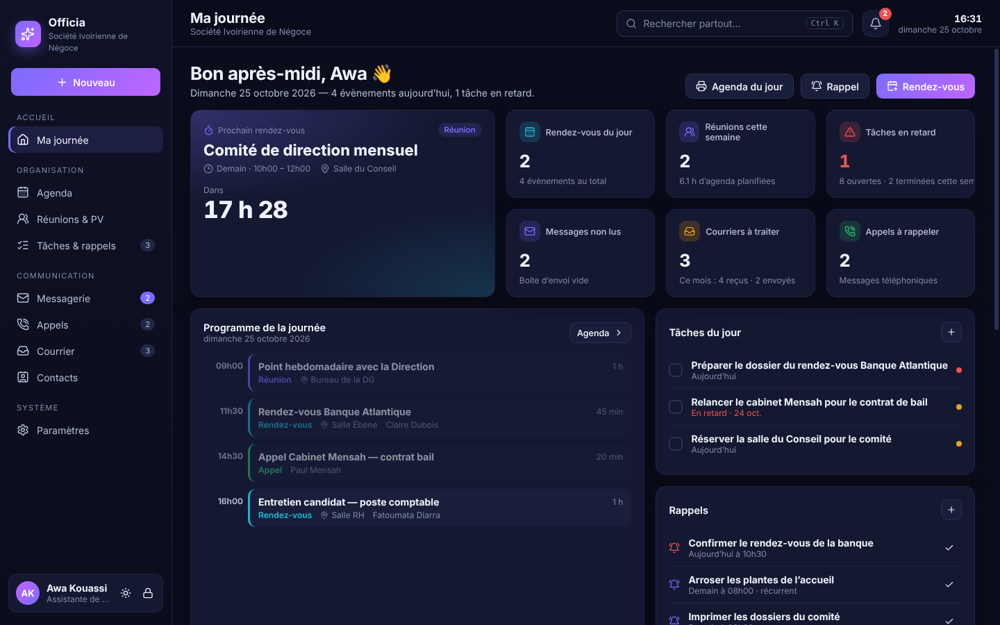
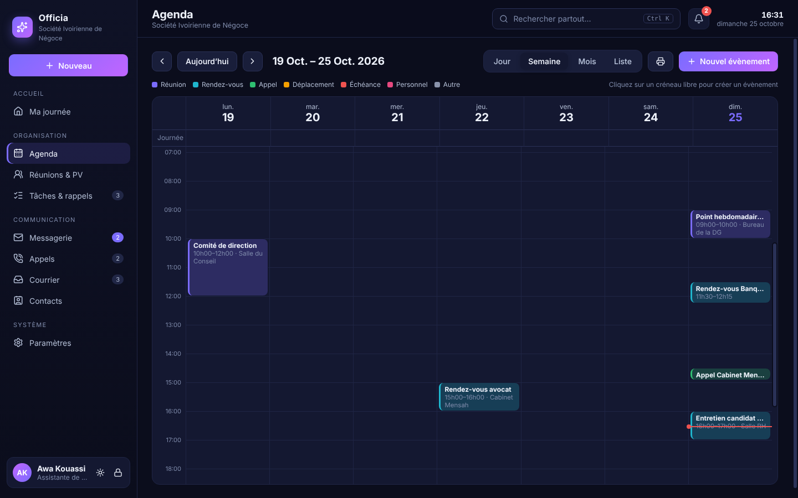
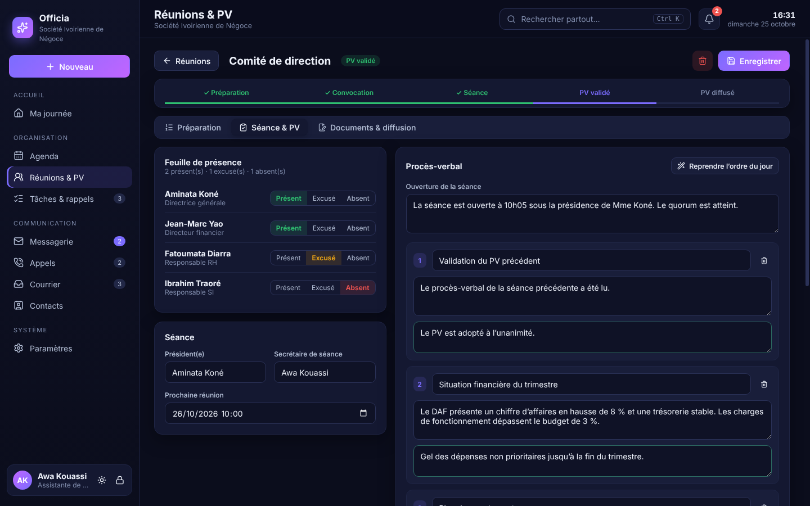
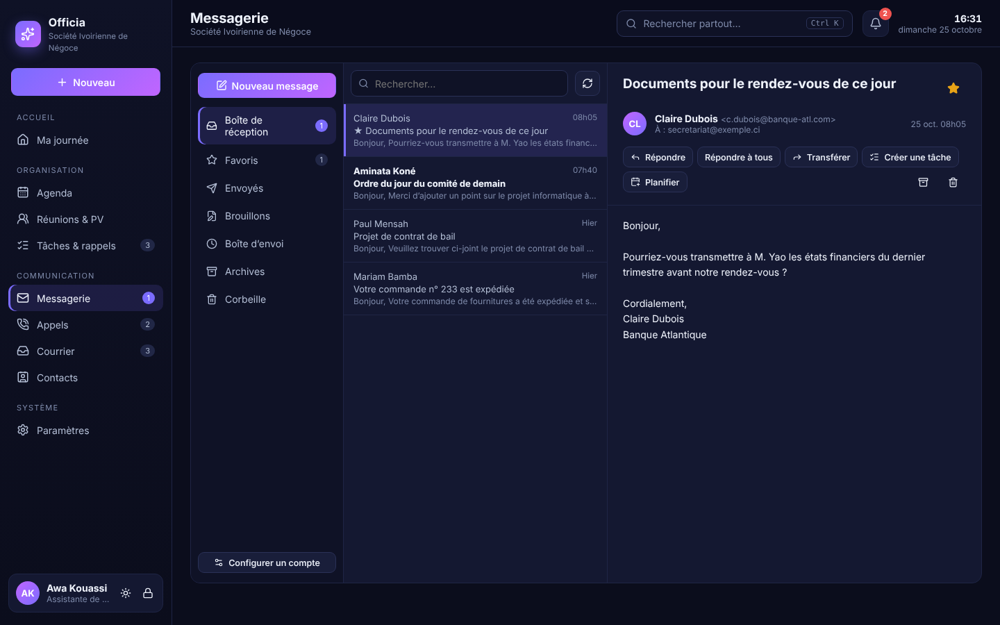

# OfficiaTech — l’assistant administratif tout-en-un

**Version 1.10** — développé par **M. TETCHI KOREY JOEL**, Comptable · +225 07 19 37 80 57 / +225 01 60 29 61 49 · heliontech97@gmail.com

Application Windows pour **assistante de direction et secrétariat** : agenda, rendez-vous, réunions et procès-verbaux, messagerie, courrier, appels, tâches, rappels et notifications, réunis dans une interface simple, élégante et professionnelle.
Tout fonctionne **sans Internet** (base locale sur le poste) ; la messagerie envoie et relève vos e-mails dès que la connexion est disponible.

📘 **Manuel d’utilisation illustré (PDF, 45 pages)** : [docs/OfficiaTech-Manuel.pdf](docs/OfficiaTech-Manuel.pdf)



| Agenda | Procès-verbal | Messagerie |
|---|---|---|
|  |  |  |

## Nouveautés de la version 1.10

- **Messagerie** : « Se connecter avec Microsoft » (Outlook, Hotmail, Microsoft 365, OAuth 2.0), relève des dossiers **Envoyés, Archives, Indésirables**, copie des envois dans « Envoyés » du serveur, **lu/non lu et favoris synchronisés** avec le téléphone, **réponses rapides**.
- **Agenda** : **invitations calendrier (.ics)** jointes aux confirmations et convocations, import/export `.ics`, rendez-vous privés, **rappel automatique des visiteurs la veille** (e-mail, ou WhatsApp/SMS en un clic).
- **Réunions** : **feuille de présence** à faire signer, **suivi des actions non terminées** d’une séance à l’autre, « Planifier la réunion suivante », remarques et validation du PV par la Direction, dictée vocale Windows (`Windows+H`).
- **Courrier** : plusieurs pièces par courrier, **numérisation directe** (scanner Windows → PDF), **circuit de traitement** (transmission, relances manuelles ou automatiques, réponse), **lettres sur papier à en-tête** (logo, mentions légales) en PDF et Word.
- **Sécurité** : **sauvegarde quotidienne vers clé USB / Google Drive / OneDrive**, restauration en un clic, **verrouillage automatique** après inactivité et au verrouillage de Windows, **mises à jour intégrées**.
- **Équipe** : serveur à installer sur votre VPS (`server/`) pour **partager agenda, réunions, tâches, courrier, appels et contacts entre plusieurs postes**, **espace mobile de la Direction** (agenda, validation des PV) et **agenda sur le téléphone** (abonnement iCal).
- **Rapport d’activité mensuel** (PDF pour la Direction, Excel).

## Fonctionnalités

### Ma journée
Tableau de bord du matin : prochain rendez-vous avec compte à rebours et bouton « Rejoindre » pour les visioconférences, programme de la journée en frise chronologique, tâches du jour à cocher, rappels, charge de la semaine, répartition par type, derniers messages, réunions à venir et **PV à rédiger**, appels à rappeler, pense-bêtes. Impression de l’**agenda du jour** pour la personne assistée.

### Agenda et rendez-vous
- Vues **jour, semaine, mois, liste** ; cliquer sur un créneau libre crée un évènement, **glisser un évènement le déplace** (durée conservée, conflit signalé).
- Types colorés : réunion, rendez-vous, appel, déplacement, échéance, personnel.
- **Détection des conflits** d’agenda pendant la saisie, **récurrences** (quotidienne, hebdomadaire, mensuelle, annuelle), participants, lieu, lien de visio, statut (planifié, confirmé, reporté, annulé).
- **Confirmation de rendez-vous par e-mail** en un clic (modèle prérempli).

### Réunions et procès-verbaux
Parcours complet en 5 étapes : **Préparation → Convocation → Séance → PV validé → PV diffusé**.
- Ordre du jour (intervenants, durées), participants depuis les contacts.
- **Convocation** mise en page (PDF) et envoyée par e-mail aux participants en pièce jointe.
- **Feuille de présence** (présent / excusé / absent), rédaction du PV point par point (échanges + décisions), relevé des actions avec responsables et échéances.
- Les **actions du PV deviennent automatiquement des tâches** suivies.
- **PV officiel en PDF** (présences, décisions, actions, signatures), validation et diffusion par e-mail.

### Messagerie
- Comptes **IMAP / SMTP** (Gmail, Outlook, Yahoo, Orange préremplis, ou tout serveur professionnel). Mot de passe **chiffré par Windows**.
- Boîte de réception, favoris, envoyés, brouillons, **boîte d’envoi hors ligne** (les messages partent automatiquement au retour de la connexion), archives, corbeille.
- **Modèles** avec variables (`{{nom}}`, `{{date}}`, `{{heure}}`, `{{lieu}}`, `{{objet}}`, `{{signature}}`…), signature, pièces jointes, suggestions de destinataires.
- Transformer un message en **tâche** ou en **rendez-vous**. Affichage HTML sécurisé (scripts et images distantes bloqués).

### Tâches et rappels
- **Tableau** glisser-déposer (À faire, En cours, En attente, Terminé), vue liste, priorités, échéances, responsables.
- **Rappels** à date et heure, récurrents, « +10 min » pour reporter.

### Notifications
- **Notifications Windows** (même application réduite) : évènement imminent selon le délai choisi, rappel arrivé à échéance, récapitulatif quotidien des tâches, courriers à échéance, appel urgent, nouveaux e-mails.
- Centre de notifications dans l’application, compteurs dans le menu, icône près de l’horloge Windows (l’application reste active fenêtre fermée), lancement au démarrage de Windows en option.

### Courrier
**Registre du courrier arrivée et départ** avec numérotation chronologique automatique (`A-2026-0001`, `D-2026-0001`), expéditeur/destinataire, objet, référence, mode de réception, attribution, échéance de traitement, statut, **scan joint**. Impression du registre et export Excel.

### Appels
Journal des **messages téléphoniques** (« pendant votre absence ») : appelant, société, numéro, pour qui, message, urgence ; « Rappelé » en un clic ou planification du rappel dans l’agenda.

### Appels, WhatsApp et SMS
Boutons **Appeler**, **WhatsApp** et **SMS** sur les contacts, le journal des appels et l’accueil ; **confirmation de rendez-vous par WhatsApp ou SMS** depuis la fiche du rendez-vous (message prérempli : date, heure, lieu, signature). Les appels et SMS passent par votre téléphone relié à Windows (application **« Lien avec Windows »**), WhatsApp par WhatsApp Desktop ou le navigateur. Les numéros locaux reçoivent l’indicatif par défaut (+225, modifiable dans Paramètres › Profil).

### Contacts
Annuaire avec favoris, étiquettes, coordonnées, **import CSV** (Excel, Outlook, Gmail : colonnes reconnues automatiquement, doublons ignorés), et **historique** par contact (rendez-vous, appels, courriers) ; actions directes : écrire, planifier, noter un appel.

### Et aussi
**Recherche globale** (`Ctrl+K`) dans tout : contacts, agenda, réunions, PV, tâches, messages, courrier, appels · bouton **Nouveau** (`Ctrl+N`) · thème sombre / clair · **déconnexion** (bouton en bas du menu, `Ctrl+L` ou icône près de l’horloge) avec **code de session** facultatif · numéro de page et mention OfficiaTech sur les PDF · reprise automatique des données d’une ancienne installation « Officia » · sauvegarde automatique quotidienne, sauvegarde et restauration manuelles · exports Excel.

---

## Installation sur Windows

1. Téléchargez `OfficiaTech-Setup-1.10.exe` dans les **Releases** du dépôt (étiquettes `officia-v…`), ou l’artefact **OfficiaTech-Windows** de l’onglet **Actions** › « OfficiaTech — installateur Windows ».
2. Les versions suivantes s’installent depuis l’application (**Paramètres › Mises à jour**). Pour publier une version : changer `version` dans `package.json`, compléter `CHANGELOG.md`, puis pousser une étiquette `officia-vX.Y.Z`.
3. Lancez l’installateur. Si SmartScreen s’affiche : **Informations complémentaires** › **Exécuter quand même** (application non signée).

Construire soi-même sur un PC Windows (Node.js 24) :
```bash
cd officia
npm install
npm run dist:win     # → release/OfficiaTech-Setup-1.10.exe
```

### Sessions
OfficiaTech gère **plusieurs sessions**, chacune avec ses propres données (agenda, messages, courrier…), sa messagerie et son **code facultatif**. Au démarrage (ou après **Se déconnecter**, `Ctrl+L`), l’écran **Choisir une session** permet d’ouvrir une session, d’en **créer une nouvelle pour les données réelles**, d’ouvrir la **session de démonstration** ou de supprimer une session. S’il n’existe qu’une seule session sans code, elle s’ouvre directement.

### Premier démarrage
Saisissez votre nom, votre fonction, l’organisation et la personne assistée. Cochez **données de démonstration** pour découvrir l’application avec un agenda, des réunions (dont un PV complet), des messages, des courriers et des appels fictifs.
Ajoutez ensuite votre adresse e-mail dans **Paramètres › Messagerie** (bouton « Tester la connexion »). Gmail et Yahoo : **mot de passe d’application**. Outlook / Hotmail / Microsoft 365 : bouton **« Se connecter avec Microsoft »**, après avoir enregistré une fois l’application sur entra.microsoft.com (étapes affichées dans l’application et dans le manuel).

### Serveur d’équipe (VPS)
```bash
cd officia/server
cp .env.example .env          # SYNC_TOKEN=… (openssl rand -hex 24)
nano Caddyfile                # votre nom de domaine → HTTPS automatique
docker compose up -d --build
```
Puis, sur chaque poste : **Paramètres › Équipe** (adresse `https://votre-domaine`, jeton). L’espace mobile de la Direction est à `https://votre-domaine/m` ; les accès se créent dans le même écran.

---

## Développement

```bash
cd officia
npm install
npm run dev     # Vite + Electron
npm test        # 20 tests : agenda, PV, notifications, courrier, SMTP/IMAP réels (dossiers, lu/non lu, OAuth XOAUTH2, .ics), synchro d'équipe, accès mobile, rapport
```

| Dossier | Rôle |
|---|---|
| `electron/db.js` | Base SQLite locale (`node:sqlite` intégré à Electron, aucun module natif) |
| `electron/services.js` | Agenda et récurrences, conflits, réunions/PV, tâches, rappels, planificateur de notifications, courrier, appels, recherche, tableau de bord |
| `electron/mail.js` | Messagerie : SMTP (nodemailer), IMAP (imapflow + mailparser), dossiers spéciaux, drapeaux, boîte d’envoi hors ligne |
| `electron/oauth.js` | Connexion Microsoft (OAuth 2.0 + PKCE, redirection locale) |
| `electron/ics.js` | Invitations et agendas iCalendar (.ics) |
| `electron/sync.js` | Synchronisation avec le serveur d’équipe |
| `server/` | Serveur d’équipe pour VPS (Node.js sans dépendance, Docker + Caddy), espace mobile `mobile.html` |
| `electron/main.js` | Fenêtre, zone de notification, notifications Windows, PDF, IPC, sauvegardes |
| `src/` | Interface React |

Données : `%APPDATA%\OfficiaTech\data\` (sauvegardes dans `sauvegardes\`, pièces jointes dans `fichiers\`).
